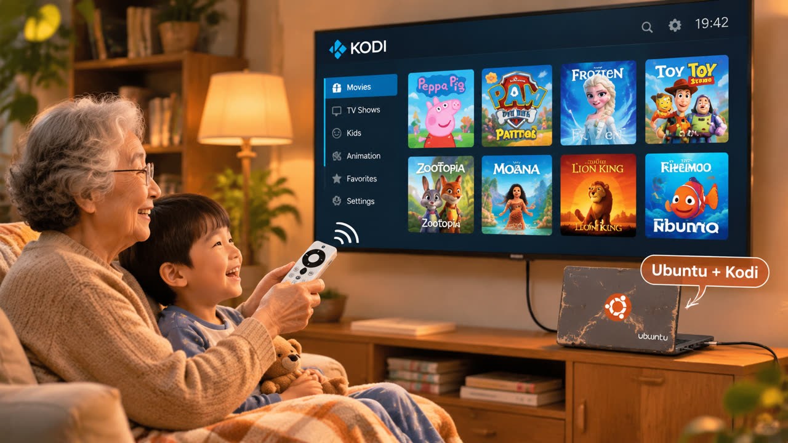

# kodi-htpc-remote



[English](#english) · [中文](#中文)

把一台 Ubuntu 笔记本/迷你主机变成客厅影音中心（Kodi），用**一个小米蓝牙语音遥控器**
全程操作，像电视一样简单——面向家里的老人和小孩。通电即用、闲置锁屏、任意键免密唤醒、
永不休眠、配置可重启后自动恢复。

> Turn an Ubuntu box into a living-room Kodi HTPC driven entirely by one Xiaomi BLE
> voice remote. TV-simple for kids and elderly users: power-on to Kodi, idle lock,
> password-less wake on any key, never sleeps, survives reboots.

---

## 中文

### 这套方案做了什么

- **遥控器接管** (`htpc-remote`)：独占抓取小米 BLE 遥控器，经 uinput 重新发出按键。
  - 电源键：锁屏/解锁切换（锁屏时先停止播放）。
  - 锁屏状态下**任意键**唤醒 + 免密解锁 + 回到 Kodi（遥控器休眠断连后也能秒接管）。
  - 长按主页：把 Kodi 调到前台（没开就启动）。
  - 长按菜单：进入“空中鼠标”——方向键移动指针，OK 左键，菜单右键，返回退出。
  - 左右键按住：连续快退/快进（绕开 Kodi longpress 不重复的限制）。
  - 语音键：播放/暂停，并抑制长按语音键产生的杂乱上报。
  - 语音键音频流：**长按语音键时遥控器会推流麦克风音频**（mSBC over HID），目前未启用，
    为语音指令、语音问答、vibe coding、Typeless 式语音输入等预留扩展，见 `docs/voice.md`。
- **udev**：把语音键/电源键重映射成可用键码，并禁止桌面直接读取遥控器（避免重连后第一键误触锁屏）。
- **Kodi 适老化**：无长按的电视式键位、固定 10 秒步长、看一半自动续播、退出自动重开、列表显示封面。
- **开机免密自启**：GDM 自动登录 + autostart 守护循环 + 禁用休眠。
- **缓存自动清理**：每天清理过期的插件缩略图，照顾低配机。
- **YouTube（可选）**：封面视图服务，以及在旧版 Kodi 上修复官方插件的两个坑。

### 硬件/软件前提

- Ubuntu 22.04 桌面版（GNOME/GDM），其它发行版需按需调整。
- 已配对、受信任的小米/红米 BLE 语音遥控器（HID `0005:2717:32B8`）。不同型号的键码可能不同。
- 已安装 Kodi（建议正式版；nightly 见 `docs/youtube.md` 的注意事项）。

### 安装

```bash
# 0) 先手动配对遥控器（只需一次），见 docs/pairing.md
git clone https://github.com/<you>/kodi-htpc-remote.git
cd kodi-htpc-remote
sudo ./install.sh
# 然后按提示编辑 /etc/htpc-remote.conf，并完成 docs/ 里的 Kodi 手动步骤
```

**先配对遥控器**：`install.sh` 只装软件，蓝牙配对要先手动做一次，见 [docs/pairing.md](docs/pairing.md)。

安装脚本会装好依赖、脚本、udev 规则、systemd 服务与定时器，以及自启动项。
Kodi 内的键位、封面视图插件、遥控器配对、GNOME 锁屏/息屏、禁用休眠需参照 `docs/` 手动完成。

### 目录结构

```
bin/        守护进程与脚本（htpc-remote / htpc-power-key / htpc-focus-kodi /
            htpc-autostart-kodi / kodi-cache-clean.py / htpc-common.sh）
udev/       语音键/电源键 hwdb 映射 + 隐藏原始设备的 libinput 规则
systemd/    htpc-remote.service、kodi-cache-clean@.service/.timer
kodi/       键位、封面视图服务插件、自启动 .desktop 示例
docs/       遥控器配对、Kodi 设置、开机自启与电源策略、YouTube、语音键扩展说明
```

### 安全说明

此方案刻意做到**任意键免密解锁**，默认机器在家庭内网、物理可信环境中使用，不适合
对安全性有要求的场景。请自行评估。

---

## English

### What it does

- **Remote takeover** (`htpc-remote`): exclusively grabs the Xiaomi BLE remote and
  re-emits keys via uinput. Power = lock/unlock toggle (stops playback before locking);
  **any key while locked** wakes + unlocks (no password) + shows Kodi; long-press Home
  focuses/starts Kodi; long-press Menu toggles an air-mouse (D-pad moves the pointer,
  OK/Menu = left/right click, Back exits); hold Left/Right for continuous seek; voice
  key = play/pause with burst suppression.
- **udev**: remaps the voice/power keys and hides the raw device from the desktop so the
  first key after a BLE reconnect never hits the lock screen.
- **Kodi for non-technical users**: long-press-free TV-style keymap, fixed 10 s seek,
  silent resume, auto-restart guard, thumbnail (Wall) views.
- **Password-less kiosk autostart**: GDM auto-login + autostart guard loop + masked sleep.
- **Cache cleanup**: a daily timer prunes stale plugin thumbnails for low-end hardware.
- **YouTube (optional)**: a tiny service that forces thumbnail views, plus notes on
  fixing the official add-on on older Kodi builds.

### Requirements

Ubuntu 22.04 desktop (GNOME/GDM); a paired, trusted Xiaomi/Redmi BLE voice remote
(HID `0005:2717:32B8` — key codes may differ by model); Kodi installed.

### Install

```bash
# 0) Pair the remote once first — see docs/pairing.md
git clone https://github.com/<you>/kodi-htpc-remote.git
cd kodi-htpc-remote
sudo ./install.sh
```

Pair the Bluetooth remote by hand once before/after install — see
[docs/pairing.md](docs/pairing.md). Then edit `/etc/htpc-remote.conf` and finish the
manual Kodi steps in `docs/`.

### Security

This project intentionally unlocks on any key without a password and assumes a trusted
home LAN / physically trusted device. Do not use it where security matters.

### License

MIT. See [LICENSE](LICENSE).
